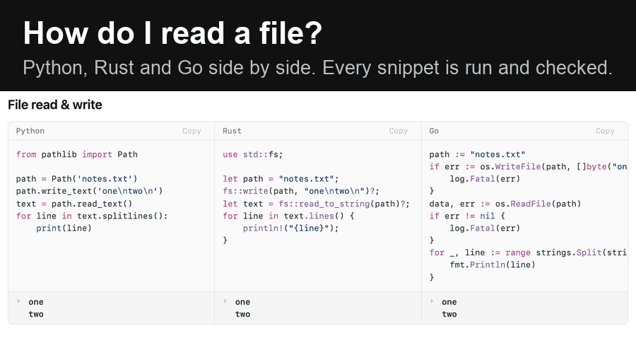

# py-go-rust

**One task, written in Python, Rust and Go, side by side, so you see the difference at a glance.** Every pattern is run and its printed output checked.

[**Compare them on the live site →**](https://pygors.xces.workers.dev/compare)

[](https://github.com/mrgnw/py-go-rust/actions/workflows/ci.yml)
[](LICENSE)
[](https://pygors.xces.workers.dev/compare)
[](https://pygors.xces.workers.dev)

> [!NOTE]
> Built with AI assistance, including Claude Code and Codex. Snippets were reviewed and run with the checker below, but check anything you depend on.

## Count words, then print the most common one

The same task in all three languages, copied from [the site](https://pygors.xces.workers.dev/algorithms#algorithms-frequency-count). The blocks run 4, 8 and 14 lines: Python has `Counter`, Rust and Go count into a map by hand. All three find `a`, 3 times.

**Python**

```python
from collections import Counter

counts = Counter('a b a c b a'.split())
print(counts.most_common(1))  # => [('a', 3)]
```

**Rust**

```rust
use std::collections::HashMap;

let mut counts = HashMap::new();
for w in "a b a c b a".split(' ') {
    *counts.entry(w).or_insert(0) += 1;
}
let top = counts.iter().max_by_key(|&(_, &n)| n).unwrap();
println!("{top:?}"); // => ("a", 3)
```

**Go**

```go
func main() {
	counts := map[string]int{}
	for _, w := range strings.Fields("a b a c b a") {
		counts[w]++
	}
	top := ""
	for w, n := range counts {
		if n > counts[top] {
			top = w
		}
	}
	fmt.Println(top, counts[top]) // => a 3
}
```

The `# =>` and `// =>` comments are the printed output. The [snippet checker](#what-the-checker-verifies) runs each block and fails if the output differs.

On the site the three sit in columns. Point at a step and it lights up in all three; pivot a branch to stack it line by line:

[](https://pygors.xces.workers.dev/compare#compare-file-read-write)

## Three ways to compare

1. **Columns.** Each of the [37 patterns](https://pygors.xces.workers.dev/compare) and [13 algorithms](https://pygors.xces.workers.dev/algorithms) is one row: Python, Rust and Go next to each other, with each column's output underneath. Hover a step, or press `.` and `,`, to light the matching lines in all three. Where the outputs differ, the differing words are highlighted.
2. **Pivot by concept.** A step split into branches has a `pivot` button that stacks the three versions of each branch, so `elif`, `} else if {` and `case` sit on top of each other. Only [if-else](https://pygors.xces.workers.dev/compare#compare-if-else-ternary-ish) has branches so far; [#2](https://github.com/mrgnw/py-go-rust/issues/2) tracks adding more.
3. **One language at a time.** Press `1`, `2` or `3` (or click `py`, `rs`, `go`) to hide a language, and drag the chips to reorder them; the choice is remembered. The [Python](https://pygors.xces.workers.dev/python), [Rust](https://pygors.xces.workers.dev/rust) and [Go](https://pygors.xces.workers.dev/go) pages cover each language alone: ownership, goroutines, zero values and the tooling.

Press `?` on the site for every shortcut, and `x=` to show variable values on hover.

## Who it is for

Python developers who want to read and write Rust or Go. Start with [when to pick each language](https://pygors.xces.workers.dev), then look up the task you already know in Python.

## What is in it

| Page                                                                                                                                     | Content                                                                                                                                 | Code blocks |
| ---------------------------------------------------------------------------------------------------------------------------------------- | --------------------------------------------------------------------------------------------------------------------------------------- | ----------- |
| [Patterns](https://pygors.xces.workers.dev/compare)                                                                                      | 37 patterns in 8 groups: basics, collections, control flow, types, errors and resources, data and I/O, concurrency, project and tooling | 108         |
| [Algorithms](https://pygors.xces.workers.dev/algorithms)                                                                                 | 13 interview patterns, from two pointers and heaps to breadth-first search and memoization                                              | 39          |
| [Python](https://pygors.xces.workers.dev/python), [Rust](https://pygors.xces.workers.dev/rust), [Go](https://pygors.xces.workers.dev/go) | One reference page per language                                                                                                         | 101         |
| [When to pick each](https://pygors.xces.workers.dev)                                                                                     | Which language for which job, and how they differ                                                                                       | 6           |

That is 254 Python, Rust and Go code blocks; the checker runs 245 of them.

## What the checker verifies

The Python, Rust and Go code fences on every page are run by [analysis/run_snippets.py](analysis/run_snippets.py), and their `=>` output is checked in order. `=>~` allows a run of output lines in any order. Examples that declare an expected compile or runtime error must fail with that text; test examples must pass their test runner.

Nine fences on the three reference pages are marked `!norun` and skipped. Shell, TOML and text fences are not run. The checker runs locally and in a pre-commit hook; **CI does not run it yet** ([#9](https://github.com/mrgnw/py-go-rust/issues/9)). CI checks formatting, Svelte/TypeScript and the static build. Passing checks do not establish that an example is suitable for production.

## Quick start

Needs Node 22 or newer and pnpm 10. No Cloudflare account or analytics configuration is needed for local development.

```sh
git clone https://github.com/mrgnw/py-go-rust.git
```

```sh
cd py-go-rust
```

```sh
pnpm install
```

```sh
pnpm dev
```

Open http://localhost:5237.

```sh
pnpm check
```

```sh
pnpm lint
```

```sh
pnpm build
```

To inspect the built site locally, preview serves `build/` on http://localhost:5238 with Wrangler:

```sh
pnpm preview
```

The site is prerendered with Svelte 5 and SvelteKit, Tailwind 4, marked and Shiki. Python scripts run the snippets and capture variable values.

### Extra development hosts

The dev server accepts a comma-separated list of extra hostnames or domain suffixes through `ALLOWED_HOSTS`. A leading dot includes subdomains. Set your hostnames in the variable first:

```sh
ALLOWED_HOSTS=
```

```sh
ALLOWED_HOSTS="$ALLOWED_HOSTS" pnpm dev
```

## Add a pattern

1. Choose a small, deterministic example of the same task in all three languages. Check the [open pattern requests](https://github.com/mrgnw/py-go-rust/issues) first.
2. Add a `###` section under the appropriate group in [10-compare.md](src/lib/content/langs/10-compare.md), with consecutive Python, Rust and Go fences. For an algorithm, add a section file under [algorithms/](src/lib/content/langs/algorithms/) and link it from [15-algorithms.md](src/lib/content/langs/15-algorithms.md).
3. Give each printing snippet its expected `# =>` or `// =>` output. Add the pattern to the index in [00-overview.md](src/lib/content/langs/00-overview.md).
4. Run the checker and capture variable values, then check the site. The [contribution walkthrough](CONTRIBUTING.md) includes a minimal three-language example, part markers and the full review checklist.

Checking snippets also needs [uv](https://docs.astral.sh/uv/), Go and stable Rust. The runner selects Python 3.15 through uv and Go 1.25.0 through `GOTOOLCHAIN`; first runs may download toolchains and dependencies.

```sh
uv run analysis/run_snippets.py src/lib/content/langs/10-compare.md
```

```sh
uv run analysis/capture_vars.py src/lib/content/langs/10-compare.md
```

Commit the content and updated `src/lib/content/vars.json` together. Installation enables a pre-commit hook that checks changed snippets and recaptures their variable values.

## Analytics

The repository ships with no visitor analytics. `src/routes/+layout.svelte` adds a tracker `<script>` to the page head only when both build-time variables are set, and only when the page is served from `pygors.xces.workers.dev`. Local runs, forks and previews never load it.

The owner publishes the live site by building locally and then uploading the build with Wrangler. The owner keeps both variables in a gitignored `.env` file next to `package.json`, which the build reads, so analytics are enabled on that deployment only. A Worker that only serves static assets has no runtime variables in Cloudflare, which is why they are build-time values.

- `PUBLIC_TRAKS_SITE`: site key passed to the tracker as `data-site`.
- `PUBLIC_TRAKS_SRC`: URL of the tracker script served by the collector.

What the tracker collects is decided by that remote script and its collector, which are not part of this repository. The code here only loads the script and defines the `window.traks` queue function; it sends no events of its own. Both variables are declared in `src/env.ts`, are public and are inlined into the prerendered HTML at build time, so the values are visible to every visitor and are a site identifier, not a secret.

## Roadmap and contributing

See [ROADMAP.md](ROADMAP.md) for planned content and improvements. [CONTRIBUTING.md](CONTRIBUTING.md) explains how to add or correct a pattern and submit a pull request. Small corrections are welcome; [good first issues](https://github.com/mrgnw/py-go-rust/issues?q=is%3Aissue%20is%3Aopen%20label%3A%22good%20first%20issue%22) are a starting point.

Use the [new pattern form](https://github.com/mrgnw/py-go-rust/issues/new?template=new-pattern.yml) to suggest a comparison, or [report an incorrect example](https://github.com/mrgnw/py-go-rust/issues/new?template=bug-report.yml). The content format is documented in [CLAUDE.md](CLAUDE.md), and the parts model is in [SPEC.md](SPEC.md).

## Sources

The side-by-side layout follows [Component Party](https://component-party.dev) and the content depth follows [Learn X in Y Minutes](https://learnxinyminutes.com), whose pages are CC BY-SA 3.0. The text and code here are written for this project: an exact-line comparison of the content against the Learn X in Y Minutes Python, Rust and Go pages found only three shared idiomatic lines (`def wrapper(*args, **kwargs):` and `body, err := io.ReadAll(resp.Body)` twice).

The `longest` function in the lifetimes section of `30-rust.md` is the same function that appears in [The Rust Programming Language](https://doc.rust-lang.org/book/ch10-03-lifetime-syntax.html), which is licensed under Apache-2.0 or MIT.

`src/lib/section-nav` is a vendored copy of the SectionNav component from the author's [svelte-bits](https://github.com/mrgnw/svelte-bits), MIT.

## License

[MIT](LICENSE)
